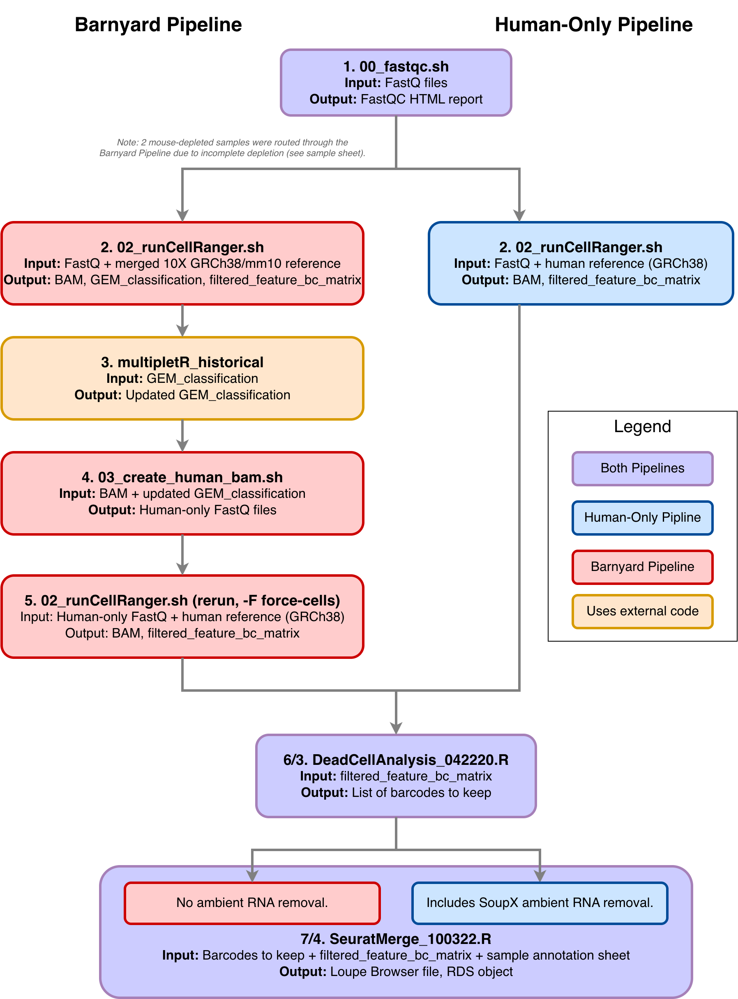

# Single-Cell RNA-Seq Pipeline — README

**Source repo/tag:** [WCCTR_RNASeq_Pipeline @ v1.0.0 / SingleCell](https://github.com/AmyOlex/WCCTR_RNASeq_Pipeline/tree/v1.0.0/SingleCell)

## Purpose

Documents the exact processing steps used for single-cell RNA-seq samples in the PDX multi-omics manuscript (*Pan-cancer comparisons of multi-omics data for therapeutic selection*, Dashti-Gibson et al.). 
All code used for single cell processing exists in other repos. This README provides a map to those repos and described the full pipeline.
The full sample sheet is provided for reference as it defines the routing between the two pipelines described below for each sample.

Two pipelines were used, depending on whether wet-lab mouse-cell depletion was performed on a given sample (see below). 
Note that the "multipletR_historical" step utilized code from the following repo: https://github.com/U4HELPP/multipletR_historical/
This repo is being release only because this is the code used for this manuscript.  
The multipletR tool has been revised and is being published under a different repository (will update link when available).

Editable source: `scRNASeq_pipeline_diagram.drawio`
---

## Barnyard Pipeline
*Mixed human/mouse PDX samples; no wet-lab mouse depletion (or depletion incomplete).*

| Step | Tool/Script | Input | Output |
|---|---|---|---|
| 1 | [`00_fastqc.sh`](https://github.com/AmyOlex/WCCTR_RNASeq_Pipeline/blob/v1.0.0/SingleCell/00_fastqc.sh) | FastQ files | FastQC HTML report |
| 2 | [`02_runCellRanger.sh`](https://github.com/AmyOlex/WCCTR_RNASeq_Pipeline/blob/v1.0.0/SingleCell/02_runCellRanger.sh) | FastQ + merged human/mouse reference (10X GRCh38/mm10) | BAM, GEM_classification, filtered_feature_bc_matrix |
| 3 | [multipletR_historical](https://github.com/U4HELPP/multipletR_historical/) | GEM_classification | Updated GEM_classification (multi-species multiplets identified) |
| 4 | [`03_create_human_bam.sh`](https://github.com/AmyOlex/WCCTR_RNASeq_Pipeline/blob/v1.0.0/SingleCell/03_create_human_bam.sh) | BAM + updated GEM_classification | Human-only FastQ files |
| 5 | [`02_runCellRanger.sh`](https://github.com/AmyOlex/WCCTR_RNASeq_Pipeline/blob/v1.0.0/SingleCell/02_runCellRanger.sh) *(rerun, human-only reference, `-F` force-cells flag)* | Human-only FastQ + human reference (GRCh38) | BAM, filtered_feature_bc_matrix |
| 6 | [`DeadCellAnalysis_042220.R`](https://github.com/AmyOlex/WCCTR_RNASeq_Pipeline/blob/v1.0.0/SingleCell/DeadCellAnalysis_042220.R) | filtered_feature_bc_matrix | List of barcodes to keep |
| 7 | [`SeuratMerge_100322.R`](https://github.com/AmyOlex/WCCTR_RNASeq_Pipeline/blob/v1.0.0/SingleCell/SeuratMerge_100322.R) *(no ambient RNA removal)* | Barcodes to keep + filtered_feature_bc_matrix + sample annotation sheet | Loupe Browser file, RDS object |

## Human-Only Pipeline
*Mouse-depleted samples; species separation skipped.*

| Step | Tool/Script | Input | Output |
|---|---|---|---|
| 1 | [`00_fastqc.sh`](https://github.com/AmyOlex/WCCTR_RNASeq_Pipeline/blob/v1.0.0/SingleCell/00_fastqc.sh) | FastQ files | FastQC HTML report |
| 2 | [`02_runCellRanger.sh`](https://github.com/AmyOlex/WCCTR_RNASeq_Pipeline/blob/v1.0.0/SingleCell/02_runCellRanger.sh) | FastQ + human reference (GRCh38) | BAM, filtered_feature_bc_matrix |
| 3 | [`DeadCellAnalysis_042220.R`](https://github.com/AmyOlex/WCCTR_RNASeq_Pipeline/blob/v1.0.0/SingleCell/DeadCellAnalysis_042220.R) | filtered_feature_bc_matrix | List of barcodes to keep |
| 4 | [`SeuratMerge_100322.R`](https://github.com/AmyOlex/WCCTR_RNASeq_Pipeline/blob/v1.0.0/SingleCell/SeuratMerge_100322.R) *(includes SoupX ambient RNA removal)* | Barcodes to keep + filtered_feature_bc_matrix + sample annotation sheet | Loupe Browser file, RDS object |
